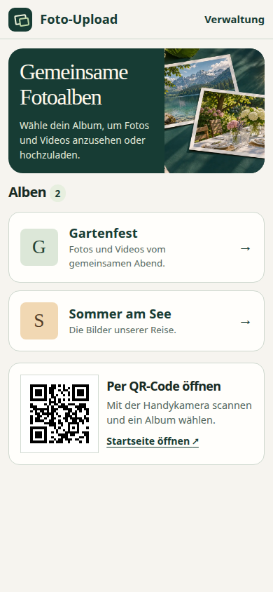

# Foto-Upload für Home Assistant

Dieses öffentliche Repository enthält zwei getrennte Komponenten:

- Das **Home-Assistant-Add-on** betreibt den vollständigen Foto-Upload-Server anstelle von CasaOS.
- Die **HACS-Integration** verbindet Home Assistant mit einem bereits laufenden Server.

HACS, Hassfest, Python-Syntax und der Add-on-Container werden bei Änderungen automatisch geprüft.

| Komponente | Version | Aufgabe |
| --- | --- | --- |
| HACS-Integration | 1.7.1 | Überwacht Server, Speicher, Alben, Uploads, Sicherungen und Freigabelinks |
| Home-Assistant-Add-on | 3.8.0 | Betreibt den vollständigen Foto-Upload-Server auf Home Assistant OS/Supervised |

Für die sichere Verbindung kopierst du in der Foto-Upload-Verwaltung unter **Sicherheit, Funnel & Updates** den nur lesbaren Home-Assistant-Status-Token. Home Assistant fragt bei einem ungültigen Schlüssel automatisch erneut danach.

- [Installation mit HACS](Private-Testinstallation.md)
- [Releases und Wartung](HACS-Veröffentlichung.md)
- [Automationen](Automationen.md)
- [Fehlerbehebung](Fehlerbehebung.md)
